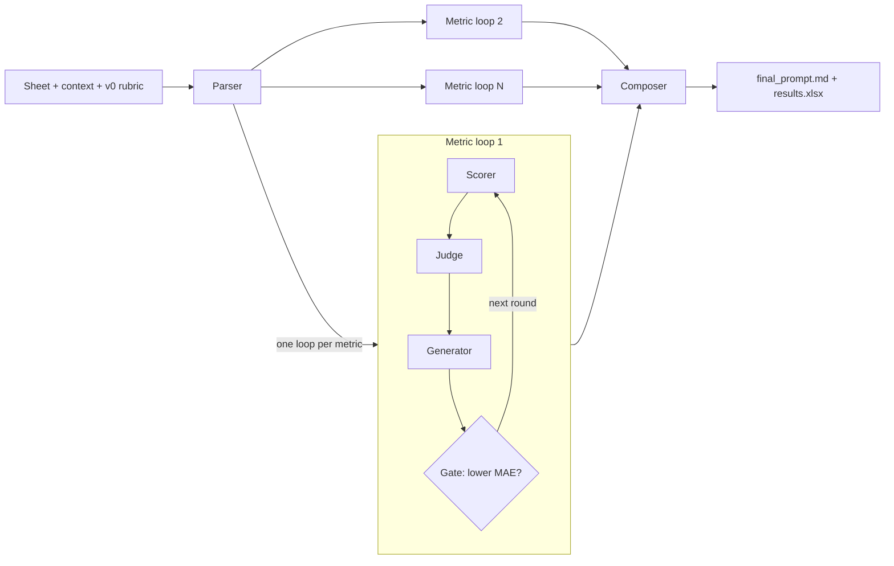

# Rubric refiner

## Overview

NGOs score submissions (answer sheets, stories, reports) with an LLM and a rubric prompt. When the model's scores
drift from the scores their own people gave, fixing the rubric by hand is slow guesswork.

The rubric refiner takes a sheet of submissions that people have already scored, the rubric in use today and a short
context note. It edits the rubric round by round until the model's scores agree with the people's scores, then hands
back the refined rubric, the agreement numbers and a results sheet with the model's full output for every submission.

It is generic: nothing in the code or the prompts is tied to one programme. Only the parts of the rubric that define
how each metric is judged are ever edited; the programme context, global rules and output format stay word for word.

## Architecture



- **Parser** (once): picks the id, input and reference columns, finds the metrics and cuts the rubric into layers:
  program, metrics (one section per metric), notes and output. Only metric sections can be edited. It asks
  questions instead of guessing.
- **Metric loops** (in parallel, one per metric), each seeing the locked layers and its own section only:
  - **Scorer** scores every submission; PDFs and images go to the model as files.
  - **Judge** reviews each miss against the reference and keeps an issue checklist; every number comes from
    deterministic code.
  - **Generator** edits the metric's section. It never sees reference values.
  - **Gate** keeps a new version only if its MAE (average gap from the reference) is lower. A loop stops at the
    round limit, at the target MAE, or after 4 rejected rounds in a row.
- **Composer**: puts each metric's best section back into the original rubric and scores it once with all metrics
  together.

```
rubric-refiner/
├── refiner/
│   ├── api.py           prepare, refine, start, stop, status, checklist, version, list_runs
│   ├── config.py        RunConfig, shared by the CLI, the API and the MCP server
│   ├── loop.py          one metric's refinement loop and issue checklist
│   ├── fanout.py        several metrics in parallel, then the composer
│   ├── agents.py        parser, scorer, judge, generator; layers and edit splicing
│   ├── math_tool.py     MAE, bias, within ±1/±2, pattern threshold
│   ├── data.py          sheets (xlsx/csv), links, attachments
│   ├── llm.py           Anthropic and OpenAI calls
│   ├── excel.py         results.xlsx
│   ├── mcp_server.py    FastMCP server
│   └── prompts/         parser.md, judge.md, generator.md
└── runs/<run>/          one folder per run (gitignored)
```

A run folder holds:
- `results.xlsx` with two tabs: **Results** (the inputs plus the final rubric's full output, one column per output
  key) and **Agreement** (exact matches, within 1 point, average gap);
- `final_prompt.md`;
- `debug.txt`;
- with several metrics, one `metrics/<key>/` folder per metric, holding every version (`versions/vN/prompt.md`,
  `change.md`).

## Install and use

```bash
uv sync
```

Inputs, placed in the project folder:

| File | What it is |
|---|---|
| `sheet.xlsx` or `sheet.csv` | one row per submission: input columns and the people's reference score(s) |
| `context.md` | short notes: which columns are inputs, which hold the reference, which metrics to refine |
| `v0.md` | the rubric prompt used today |
| `output_schema.json` | optional: the JSON the scorer must return |
| `docs/` | optional: local copies of files whose links cannot be downloaded |

Check the setup first (columns, metrics, layers, attachments, open questions), then refine with the same command
without `--prepare`. Rerunning a command resumes its run.

```bash
uv run refiner --sheet sheet.xlsx --context context.md --prompt v0.md --schema output_schema.json --run runs/my-run --prepare
uv run refiner --sheet sheet.xlsx --context context.md --prompt v0.md --schema output_schema.json --run runs/my-run
```

All options:

| Option | Default | What it sets |
|---|---|---|
| `--sheet` | required | the sheet of submissions (`.xlsx` or `.csv`) |
| `--sheet-name` | fullest sheet | which sheet of an Excel file to read |
| `--context` | required | the context notes |
| `--prompt` | required | the rubric in use today (v0) |
| `--schema` | none | the output schema the scorer answers in |
| `--run` | required | the run folder |
| `--docs-dir` | none | local copies of linked files, matched by name |
| `--model` | `gpt-6.1-sol` | model for the **parser**, **judge** and **generator** |
| `--scorer` | same as `--model` | model for the **scorer** (use the one you run in production) |
| `--effort` | `high` | reasoning effort for every model and provider: `low`, `medium`, `high` |
| `--rounds` | `8` | most rounds per metric |
| `--patience` | `4` | stop a metric after this many rejected rounds in a row |
| `--target` | none | stop a metric once its MAE reaches this |
| `--n` | all | use only the first N submissions |
| `--workers` | `8` | parallel model calls per metric |
| `--prepare` | off | set up only and print the setup |

`--model` and `--scorer` take any supported model name; the provider is picked from the name, and `--effort`
works the same way for all of them.

From Python, with the same options as `RunConfig` fields:

```python
from refiner import RunConfig, prepare, start, status

cfg = RunConfig(sheet="sheet.xlsx", context="context.md", prompt="v0.md", schema="output_schema.json",
                run="runs/my-run", model="gpt-6.1-sol", scorer="gpt-6.1-sol", effort="high")
prepare(cfg)          # review it, or answer its questions in the context file
start(cfg)            # runs in the background
status("runs/my-run")
```

## FastMCP server

The same functions are available as MCP tools: `prepare_run`, `start_run`, `run_status`, `get_checklist`,
`get_version`, `get_final_prompt`, `list_runs` and `stop_run`. Long tasks start in the background and return at
once, so poll `run_status`. Paths are relative to the project folder.

- **Claude Code**: open this folder; `.mcp.json` starts the server.
- **Claude Desktop**:

  ```bash
  uv run fastmcp install claude-desktop refiner/mcp_server.py:mcp --name rubric-refiner \
      --project "$PWD" --env REFINER_WORKDIR="$PWD"
  ```

  Then set `command` in `claude_desktop_config.json` to the full path of `uv` (from `which uv`) and restart Claude
  Desktop. It starts servers with a short PATH, so a plain `uv` is not found.
- **By hand**: `uv run fastmcp run refiner/mcp_server.py:mcp`

The flow:
1. `prepare_run`.
2. `run_status` until the setup is ready; answer any questions in the context file.
3. `start_run`.
4. `run_status` while it runs.
5. `get_final_prompt`.
