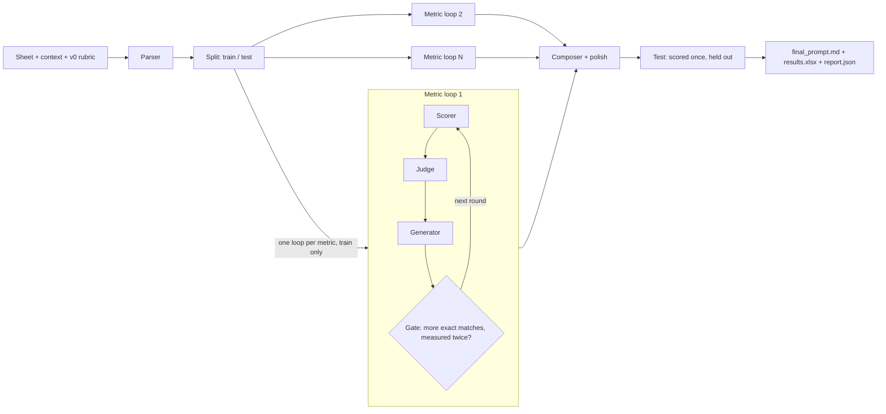

# Rubric refiner

## Overview

NGOs score submissions (answer sheets, stories, reports) with an LLM and a rubric prompt. When the model's scores
drift from the scores their own people gave, fixing the rubric by hand is slow guesswork.

The rubric refiner takes a sheet of submissions that people have already scored, the rubric in use today and a short
context note. It edits the rubric round by round until the model's scores agree with the people's scores, then hands
back the refined rubric, the agreement numbers and a results sheet with the model's full output for every submission.

It is generic: nothing in the code or the prompts is tied to one programme. Only the parts of the rubric that define
how each metric is judged are ever edited; the programme context, global rules and output format stay word for word.

## Architecture



- **Parser** (once): picks the id, input and reference columns, finds the metrics and cuts the rubric into layers:
  program, metrics (one section per metric), procedure (shared scoring logic, when the rubric has one), notes and
  output. Only the metrics and procedure layers can be edited. It asks questions instead of guessing.
- **Split** (once, seeded, stratified by reference score): `--split 80/20` puts a fifth of the submissions aside.
  Everything the loops do — scoring, judge notes, the checklist, the gate, the stop rules — uses the train items
  only. The test items are scored once at the end, with the original and the final rubric, so their numbers are out
  of sample. `100/0` disables the holdout.
- **Metric loops** (in parallel, one per metric), each seeing the locked layers and its own section only:
  - **Scorer** scores every train submission; PDFs and images go to the model as files.
  - **Judge** reviews each miss against the reference and keeps an issue checklist; every number comes from
    deterministic code.
  - **Generator** edits the metric's section. It never sees reference values.
  - **Gate** keeps a new version when it has more exact matches than the best (ties fall to MAE, then to length),
    measured twice: a first-pass winner is scored once more and the pooled numbers decide. A loop stops at the
    round limit, at the target MAE, or after 4 rejected rounds in a row; then a shrink loop compresses the best
    version while the exact matches hold.
- **Composer**: puts each metric's best section back into the original rubric and scores it once with all metrics
  together; a short **polish** stage then tunes the weakest part against the whole prompt.

```
rubric-refiner/
├── refiner/             each folder has a CLAUDE.md with one line per file
│   ├── agents/          parser, scorer, judge, generator, layers, math_tool, llm, models, providers/
│   ├── engine/          items, split, loop, fanout (+ composer, polish, test pass), run, report, events
│   ├── mcp/             server.py (actions), routes.py (HTTP), inspect.py
│   ├── prompts/         every prompt: system/, user.py, judge_tools.py, mcp.py
│   ├── utils/           excel, documents, downloads, files, process
│   ├── api.py           prepare, refine, start, stop, status, checklist, version_report, rubric, report
│   ├── config.py        RunConfig + DEFAULTS + HELP, shared by the CLI, the API and the MCP server
│   └── paths.py         refiner-data/ layout
├── models.yaml          every model: provider, roles, effort options, pricing; the UI reads it at GET /models
├── refiner-data/        the server's files per chat: chats/<chat_id>/{inputs/, run/} (gitignored)
├── docs/                architecture.md, database.md (tables, memory, pg_cron heartbeat), transport.md (SSE)
└── runs/<run>/          one folder per run (gitignored)
```

A run folder holds:
- `results.xlsx`: **Results** (the inputs plus the final rubric's full output, one column per output key),
  **Agreement** (exact matches, within 1 point, average gap — one row per metric for train, and for test once it is
  scored), **Items** (every submission with its split, reference and scores), and the versions, rounds, checklist,
  judge notes and edits;
- `final_prompt.md`, `report.json` (train and test numbers per metric, the version lineage, every version's section);
- `setup/split.json` (which ids are train and test), `debug.txt`;
- with several metrics, one `metrics/<key>/` folder per metric, holding every version (`versions/vN/prompt.md`,
  `change.md`), plus `composed/` and `polish/`.

## Install and use

```bash
uv sync
```

Inputs, placed in the project folder:

| File | What it is |
|---|---|
| `sheet.xlsx` or `sheet.csv` | one row per submission: input columns and the people's reference score(s) |
| `context.md` | short notes: which columns are inputs, which hold the reference, which metrics to refine |
| `v0.md` | the rubric prompt used today |
| `output_schema.json` | optional: the JSON the scorer must return |
| `docs/` | optional: local copies of files whose links cannot be downloaded |

Check the setup first (columns, metrics, layers, attachments, split sizes, open questions), then refine with the
same command without `--prepare`. Rerunning a command resumes its run; the split, `--n` and the models are fixed
at preparation, and a resume with other models is refused.

```bash
uv run refiner --sheet sheet.xlsx --context context.md --prompt v0.md --schema output_schema.json --run runs/my-run --prepare
uv run refiner --sheet sheet.xlsx --context context.md --prompt v0.md --schema output_schema.json --run runs/my-run
```

All options (`uv run refiner --help` prints the same list; the defaults live in `refiner/config.py`):

| Option | Default | What it sets |
|---|---|---|
| `--sheet` | required | the sheet of submissions (`.xlsx` or `.csv`) |
| `--sheet-name` | first sheet | which sheet of an Excel file to read |
| `--context` | none | optional context notes (which columns are inputs, which hold the reference, answers to the parser's questions); without them the parser works from the sheet and the rubric |
| `--prompt` | required | the rubric in use today (v0) |
| `--schema` | none | the output schema the scorer answers in |
| `--run` | required | the run folder |
| `--docs-dir` | none | local copies of linked files, matched by name |
| `--model` | the `judge` default in `models.yaml` | model for every agent; the per-agent options override it |
| `--scorer` | same as `--model` | model for the **scorer** (use the one you run in production) |
| `--scorer-effort` | `low` | reasoning effort for the scorer alone (production scorers run lean) |
| `--parser-model`, `--judge-model`, `--generator-model` | same as `--model` | one agent's model |
| `--effort` | `high` | reasoning effort for every other model: `low`, `medium`, `high` |
| `--rounds` | `8` | most rounds per metric |
| `--patience` | `4` | stop a metric after this many rejected rounds in a row |
| `--target` | none | stop a metric once its MAE on train reaches this |
| `--n` | all | use only the first N submissions (fixed at preparation) |
| `--split` | `80/20` | train/test share; the rubric is tuned on train only, test is scored once at the end (`100/0` = no holdout) |
| `--seed` | `0` | which submissions go to train and test |
| `--workers` | `24` | parallel model calls |
| `--prepare` | off | set up only and print the setup |

`--model` and `--scorer` take any model in `models.yaml` (or any name the providers route by prefix); `--effort`
works the same way for all of them.

From Python, with the same options as `RunConfig` fields:

```python
from refiner import RunConfig, prepare, start, status

cfg = RunConfig(sheet="sheet.xlsx", context="context.md", prompt="v0.md", schema="output_schema.json",
                run="runs/my-run", scorer="claude-sonnet-5-5", effort="high", split="80/20", seed=0)
prepare(cfg)          # review it, or answer its questions in the context file
start(cfg)            # runs in the background
status("runs/my-run")
```

## FastMCP server

The same functions are available as MCP actions, each taking the chat id (files are named as uploaded):
`list_inputs`, `inspect_inputs`, `add_context_note`, `prepare_run`, `start_run`, `run_status`, `stop_run`,
`get_checklist`, `get_version_report`, `get_rubric`, `get_report`, `get_final_prompt`. Long tasks start in the
background and return at once, so poll `run_status`.

- **Claude Code**: open this folder; `.mcp.json` starts the server.
- **Claude Desktop**:

  ```bash
  uv run fastmcp install claude-desktop refiner/mcp/server.py:mcp --name rubric-refiner \
      --project "$PWD" --env RUBRIC_REFINER_DATA="$PWD/refiner-data"
  ```

  Then set `command` in `claude_desktop_config.json` to the full path of `uv` (from `which uv`) and restart Claude
  Desktop. It starts servers with a short PATH, so a plain `uv` is not found.
- **By hand**: `uv run fastmcp run refiner/mcp/server.py:mcp`, or `uv run refiner-server` for HTTP on 127.0.0.1:8765.

The flow:
1. `prepare_run`.
2. `run_status` until the setup is ready; answer any questions in the context file.
3. `start_run`.
4. `run_status` while it runs.
5. `get_report`, `get_final_prompt`.
